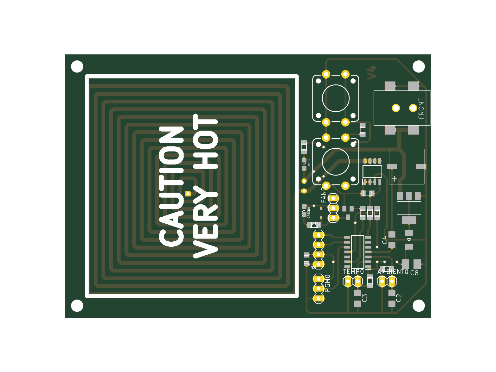

<!-- datasheet:banner -->

  <picture>
    <source media="(prefers-color-scheme: dark)" srcset=".github/assets/banner-dark.svg">
    
  </picture>

<!-- /datasheet:banner -->

# Solder Reflow Pad

**A PCB that is its own hotplate: push 12 V through a spiral of copper and it gets hot, with an ATtiny1614, an OLED, two buttons and a buzzer on the same board to run it.**

It is meant for reflowing small SMD boards, desoldering small ICs and prototyping on the bench. The heater is a square copper spiral that covers most of the board, and the controller sits beside it. The front silkscreen says CAUTION VERY HOT across the heater, and it means it.

  

<!-- datasheet:figure -->
## At a glance

  <picture>
    <source media="(prefers-color-scheme: dark)" srcset=".github/assets/diagram-dark.svg">
    
  </picture>

| Characteristic | Detail |
| --- | --- |
| **Board** | 95.25 × 68.56 mm, 2 layers, 1.6 mm FR-4, four M3 mounting holes; 2 oz copper and ENIG recommended |
| **Heater** | A square copper spiral (the `1MM_HOT_PLATE` footprint) covering most of the board, fed from a 12 V DC jack |
| **Control** | ATtiny1614 (SOIC-14) switching an AO4406AL MOSFET, with a 5 V regulator, a 2N3904, an OLED header, two 12 mm buttons, two LEDs and a buzzer |
| **Headers** | Thermistor (`TEMP0`), ambient sensor (`AMBIENT0`), fan (`FAN0`) and programming (`PGM0`) |
| **Not included** | A schematic (the project is board-only), firmware and ready-made Gerbers |
<!-- /datasheet:figure -->

## Quick start

1. Open `Solder Refow Pad Silkscreen.kicad_pro` in KiCad 10 (the file names keep the old spelling "Refow").
2. Export Gerbers and drills: **File > Fabrication Outputs**.
3. Order a 2-layer, 1.6 mm FR-4 board, **2 oz copper** (the heater traces carry the current) and **ENIG**, with a high-temperature solder mask.

## What's on the board

| Group | Parts |
|---|---|
| Heater | `U$1` (`1MM_HOT_PLATE`): the copper spiral |
| Power | `U$2` 12 V DC jack, `U$3` REG1117-5.0 regulator (SOT-223), `D2` 1N4007, `D1` 1N4148 |
| Control | `IC1` ATtiny1614 (SOIC-14), `Q1` AO4406AL MOSFET (SOIC-8), `T2` 2N3904 |
| Interface | `START0` and `SELECT0` 12 mm tactile buttons, `RED0` and `GREEN0` LEDs, `SV1` OLED header (4 pins), `SPKR0` buzzer |
| Headers | `TEMP0` thermistor, `AMBIENT0` ambient sensor, `FAN0` fan (3 pins), `PGM0` programming (3 pins) |
| Passives | `C1` 0.1 µF, `C2` to `C4` 10 µF, `C8` 47 µF / 16 V, `R1`, `R6`, `R9`, `R10` 1 kΩ, `R2`, `R3`, `R5` 10 kΩ, `R4`, `R12` 4.7 kΩ |

## Board specifications

| Parameter | Specification |
|---|---|
| Dimensions | 95.25 × 68.56 mm |
| Mounting | Four 3.2 mm (M3) holes |
| Layers | 2 (`F.Cu`, `B.Cu`) |
| Material and thickness | FR-4, 1.6 mm |
| Recommended copper | 2 oz (70 µm) for the heating traces |
| Surface finish | ENIG, for oxidation resistance at reflow temperatures |
| Silkscreen | Front only: CAUTION VERY HOT across the heater, `FRONT`, `V4`, and the part labels |
| CAD | KiCad 10 (`.kicad_pcb`, `.kicad_pro`) |

## Typical application

* **Reflow a small board:** put solder paste and parts on a small board, rest it on the spiral, power the pad from 12 V and let the controller bring it up to temperature. The ATtiny1614 switches the heater through `Q1` and reads the thermistor on `TEMP0`; you supply the firmware.
* **Fix a stubborn IC:** use it as a preheater under a board you are reworking.
* **Keep the temperature honest:** fix the thermistor on `TEMP0` to the plate with high-temperature silicone or Kapton tape, so the readings are the plate's and not the air's.

Power the pad with thick wire (16 to 18 AWG silicone) to keep the resistive losses out of the connections.

## Absolute maximum ratings

| Parameter | Limit |
|---|---|
| Supply | 12 V (the DC jack part is the `12V` footprint); logic runs from the REG1117-5.0 regulator |
| Heater trace width | 1 mm (`1MM_HOT_PLATE`) |
| Board size | 95.25 × 68.56 mm |
| Things you should touch while it is on | 0 |

## Errata

* There is **no schematic**: `Solder Refow Pad Silkscreen.kicad_sch` is an empty sheet, because the design came into KiCad as a board only.
* There is **no firmware, bill of materials or ready-made Gerber set** in this repository.
* The heater's resistance, power and safe maximum temperature are not specified here. Measure the spiral and size your supply before you power it, and treat the first run as an experiment.
* An earlier version of these notes suggested an aluminium-core board. This layout uses two copper layers, which aluminium-core boards generally do not offer, so FR-4 is the safe choice.

## Credit and origin

This board is based on **John Bradnam's open-source SMD Reflow Hot Plate**, an ATtiny1614 hotplate published under the **GPL-3.0-or-later** licence: [project page on Hackster](https://www.hackster.io/john-bradnam/smd-reflow-hot-plate-new-version-edc02e). It came into KiCad from Eagle; the leftover references `U$1`, `U$2`, `U$3` and the `dummyfp` mounting holes are from that import. The KiCad project and the silkscreen artwork layer are mine.

## License

GPL-3.0-or-later (matching the upstream design). See [LICENSE](LICENSE).

<!-- datasheet:footer -->
---

  <a href="https://github.com/S-k404/heater-driver-v4">&larr; U16 heater-driver-v4</a> &middot;
  <a href="https://github.com/S-k404/S-k404">SK-404 index</a> &middot;
  <a href="https://github.com/S-k404/pi5-homelab-rack">U18 pi5-homelab-rack &rarr;</a>

<!-- /datasheet:footer -->
