<!-- datasheet:banner -->
<p align="center">
  <picture>
    <source media="(prefers-color-scheme: dark)" srcset=".github/assets/banner-dark.svg">
    
  </picture>
</p>
<!-- /datasheet:banner -->

# Solder Reflow Pad & Hotplate PCB (KiCad)

A custom open-source KiCad printed circuit board designed for miniature SMD solder reflow, hotplate prototyping, and hardware assembly with custom top and bottom silkscreen artwork.

---

<!-- datasheet:figure -->
## At a glance

<p align="center">
  <picture>
    <source media="(prefers-color-scheme: dark)" srcset=".github/assets/diagram-dark.svg">
    
  </picture>
</p>
<!-- /datasheet:figure -->

## 🛠️ Overview & Architecture

This project provides a compact PCB hotplate design tailored for reflowing surface-mount devices (SMD), desoldering small ICs, and prototyping on a workbench.

- **CAD Suite**: Designed in **KiCad 10** (`.kicad_pcb`, `.kicad_sch`, `.kicad_pro`).
- **Layers**: 2-layer design (`F.Cu` / `B.Cu`) with standard 1.6mm board thickness (compatible with aluminum core substrate or standard FR-4).
- **Integrated Heating Element**: Custom `1MM_HOT_PLATE` layout engineered for controlled thermal dissipation.
- **Circuitry & Footprints**:
  - `SOIC127P600X175-14N` footprint for control and logic.
  - Standard `0805` and `1206` passive footprints for current limiting and decoupling capacitors.
  - Multi-pin headers (`MA03-1`, `MA04-1`, `1X03`) for power input, thermistor/thermocouple sensing, and external MCU telemetry.
  - Custom high-contrast silkscreen typography (`V4`) and reference indicators.

---

## 📐 Board Specifications

| Parameter | Specification |
| :--- | :--- |
| **Board Dimensions** | Standard bench form factor with M3 mounting holes |
| **Layer Count** | 2 Layers (`F.Cu`, `B.Cu`) |
| **Base Material** | FR-4 (or Aluminum Metal Core PCB / IMS for superior heat distribution) |
| **Finished Thickness** | 1.6 mm |
| **Recommended Copper** | **2 oz (70 µm)** minimum recommended for heating traces |
| **Surface Finish** | **ENIG (Electroless Nickel Immersion Gold)** for oxidation resistance at reflow temperatures |
| **Solder Mask** | High-temperature matte black or white |

---

## 📂 Project Structure

```
Solder Reflow Pad Silkscreen/
├── Solder Refow Pad Silkscreen.kicad_pcb   # Complete routed PCB layout & thermal geometry
├── Solder Refow Pad Silkscreen.kicad_sch   # Schematic design file
├── Solder Refow Pad Silkscreen.kicad_pro   # KiCad project definition
├── .gitignore                              # Clean repo exclusions
└── README.md                               # Hardware documentation & fabrication guidelines
```

---

## ⚡ Fabrication & Assembly Recommendations

1. **Substrate Selection**: For maximum thermal conductivity and rapid, even heat spread, export Gerbers and order as an **Aluminum Core PCB (MCPCB)**. If manufactured on standard FR-4, keep peak temperatures within rated limits (<240°C for lead-free SAC305 reflow profiles).
2. **Thermal Sensor**: Solder an NTC thermistor (or K-type thermocouple probe) directly to the designated sensing pads with high-temperature silicone or Kapton tape to ensure accurate closed-loop PID control.
3. **Power Delivery**: Use thick gauge wire (16–18 AWG silicon wire) for power delivery connections to minimize resistive losses across header pins.

---

## 📄 License

Open Hardware design released under the **CERN Open Hardware Licence Version 2 - Permissive (CERN-OHL-P)** or MIT.
